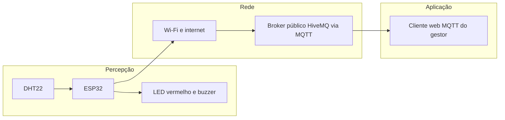

# Monitor do Depósito

Protótipo acadêmico para monitorar a temperatura e a umidade do depósito do Grupo Pleno, com alarme local e acompanhamento remoto por MQTT.

**Autor:** Luis Augusto Silva de Sá  
**Matrícula:** 0020016349  
**Formação:** IoT — Compet Superior — Senac PE  
**Caminho escolhido:** B — MQTT no HiveMQ

## Executar e avaliar

1. Abra [o projeto no Wokwi](https://wokwi.com/projects/480052950287785985).
2. Inicie a simulação e acompanhe o monitor serial em 115200 baud.
3. Abra o [cliente web do HiveMQ](https://www.hivemq.com/demos/websocket-client/).
4. Use um ClientID próprio, diferente do ESP32, como `gestor-0020016349-avaliacao`. Deixe usuário e senha vazios e conecte usando as configurações de WebSocket do cliente web.
5. Adicione a assinatura `senac/iot/0020016349/#`, com QoS 0.
6. Observe as mensagens em Messages. Clique no DHT22 no Wokwi para alterar temperatura e umidade.

O ESP32 usa `broker.hivemq.com`, porta TCP 1883. O cliente web usa WebSocket; sua porta não é a porta TCP 1883. Os dados deste caminho são vistos no cliente MQTT, sem atualização automática do ThingSpeak. Execute apenas uma cópia para evitar misturar mensagens dos mesmos tópicos.

Para reproduzir em outra cópia do Wokwi, use `sketch.ino`, `diagram.json` e `libraries.txt` deste repositório.

## Funcionamento

- Leitura do DHT22 programada a cada 2 segundos.
- Leituras com erro, não finitas ou fora da faixa são ignoradas. O alarme mantém o estado e a telemetria fica suspensa até uma leitura válida.
- O alarme liga acima de 29 °C e desliga somente abaixo de 28 °C. Nos limites exatos, mantém o estado anterior.
- Temperatura, umidade e estado do alarme são publicados a cada 5 segundos quando há conexão e leitura válida.
- Uma ativação gera um alerta. Não há publicação de alerta a cada leitura enquanto o alarme continua ligado.
- O LED verde responde a comandos ON/OFF e o dispositivo publica a confirmação.
- Status online e Last Will offline são retidos. O check-in também é retido.

## Arquitetura nas três camadas



O ESP32 lê o sensor e decide o alarme localmente. Pela rede, envia mensagens ao broker. O gestor acompanha temperatura, umidade e alertas ao assinar os tópicos no cliente web.

## Componentes e ligações

| Componente | Conexão |
|---|---|
| DHT22 | SDA no GPIO 15; VCC em 3V3; GND comum |
| LED vermelho | GPIO 2, resistor de 220 ohms em série e GND |
| LED verde | GPIO 16, resistor de 220 ohms em série e GND |
| Buzzer | GPIO 4 e GND |

Bibliotecas: PubSubClient e DHT sensor library for ESPx (DHTesp). WiFi é fornecida pelo ambiente ESP32.

## Tópicos MQTT

Prefixo: `senac/iot/0020016349/`.

| Sufixo | Conteúdo |
|---|---|
| `checkin` | Matrícula, limite e ClientID, retido |
| `status` | online/offline, retido |
| `sala1/telemetria` | JSON com mat, t, h e alarme |
| `sala1/alerta` | JSON com evento ALERTA, temperatura e limite |
| `sala1/cmd/led` | Comando ON ou OFF para LED verde |
| `sala1/ack` | LED=ON ou LED=OFF |

Exemplo de telemetria:

```json
{"mat":"0020016349","t":24.0,"h":55.0,"alarme":0}
```

## Roteiro de validação e vídeo

Mantenha Wokwi e Messages visíveis, com a matrícula nas mensagens. Espere as leituras e os envios entre alterações.

| Teste | Ação | Resultado esperado |
|---|---|---|
| T1 normal | Temperatura em 27 °C | LED apagado e telemetria chegando com alarme 0 |
| T2 alarme | Aumentar para 30 °C | LED aceso e mensagem no tópico de alerta |
| Histerese adicional | Reduzir de 30 para 28,5 °C | LED permanece aceso |
| T3 retorno | Reduzir para 27 °C | LED apaga e telemetria mostra alarme 0 |

O autor informou que os testes funcionaram. Uma captura compartilhada durante o desenvolvimento mostrou telemetria com 24 °C, umidade 55% e alarme 0 no cliente HiveMQ. O vídeo de até 60 segundos será a evidência dos três testes para a entrega; ainda não está incluído neste pacote.

Sugestão de gravação: 0–15 s identificação e T1; 15–35 s T2 e alerta recebido; 35–55 s T3 e retorno; 55–60 s visão final.

## Escolha do protocolo e evolução

MQTT permite ao gestor receber publicações por assinatura e também enviar comandos. Em comparação com HTTP, evita consultas repetidas do cliente para obter novas mensagens. Como desvantagem, exige um broker e gerenciamento da conexão; este projeto não mantém histórico em gráfico automaticamente.

Regra futura: leitura de umidade → acima de 70% por três leituras consecutivas → enviar alerta ao gestor.

## Segurança e limites

| Risco | Medida proposta para uma implantação real |
|---|---|
| Credenciais expostas no código público | Guardar segredos fora do repositório e usar credenciais individuais; esta versão utiliza somente o Wi-Fi público de simulação |
| Broker público permite leitura e publicação por terceiros | Usar broker privado, autenticação e regras de acesso por dispositivo e tópico |
| Tráfego TCP 1883 sem criptografia | Usar MQTT com TLS, validação do certificado e infraestrutura compatível |

Esta demonstração publica com QoS 0: não há garantia de entrega. O retorno positivo de publish indica envio pelo cliente, sem confirmar recebimento pelo gestor. O último alerta pendente fica apenas em RAM; múltiplas ativações offline podem sobrescrevê-lo e um reinício o perde. Uma implantação que não possa perder eventos precisaria de fila persistente e confirmação, com identificadores para deduplicação.

As reconexões podem bloquear brevemente o laço e atrasar a leitura programada. O protótipo não é um sistema de segurança industrial.

## Entrega e autoria

- Código e circuito incluídos neste repositório.
- Projeto executável: link do Wokwi acima.
- Dossiê PDF e vídeo: ainda precisam ser adicionados para concluir a entrega.
- Uso de IA: houve apoio do ChatGPT/Codex para adaptar o código, explicar MQTT e histerese e organizar a documentação. O aluno deve revisar o material e conseguir explicar a implementação.
- A declaração sobre trabalho em dupla e a reflexão sobre o painel IH Alagou devem ser preenchidas pelo autor com base na experiência real.
